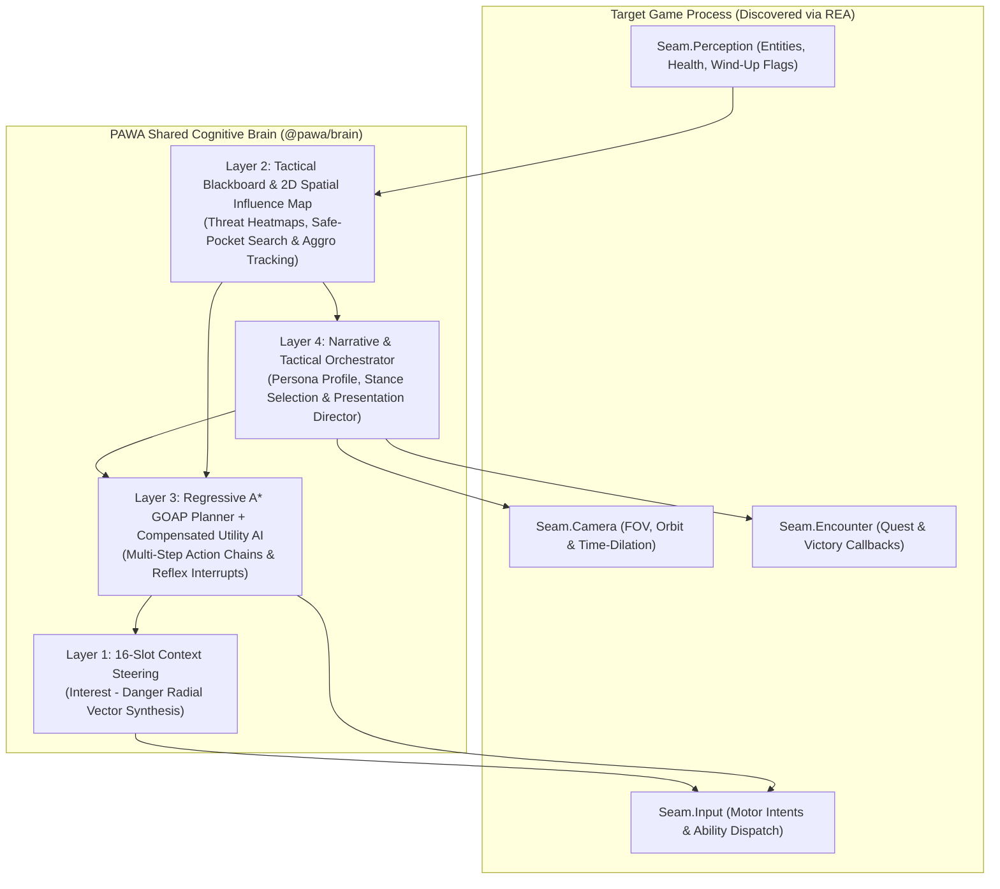

<div align="center">

# PAWA
### Persona-Aligned World Autonomy

**An Open-Source Cognitive Architecture & Reverse-Engineering Protocol for Autonomous Protagonist Agents in Single-Player Games**

[](LICENSE)
[](#3-shared-multi-language-brain-sdk-packages)
[](skills/pawa/SKILL.md)
[](paper/WHITEPAPER.md)

[Whitepaper & Math](paper/WHITEPAPER.md) · [Agent Skill Protocol](skills/pawa/SKILL.md) · [Shared Brain SDK](packages/) · [Persona Schemas](schemas/archetypes.json) · [Target Recipes](targets/)

</div>

---

## Abstract

Narrative-driven games frequently cast the player as an elite covert operative, a mythic mercenary, or a veteran battlefield commander, yet rely strictly on repetitive manual motor execution across hundreds of filler combat encounters. Existing "bot takeover" toggles (`is_human = false` in sandbox battle simulators or idle-takeover scripts in co-op shooters) fail to bridge this gap: standard NPC brains are engineered as expendable opposition and immediately degrade into naive "charge-nearest-enemy" loops when bound to a player character.

**PAWA (Persona-Aligned World Autonomy)** is both an **AI Coding Agent Skill** (built to operate alongside [REA — Reverse Engineer Anything](skills/pawa/SKILL.md)) and a **Shared Multi-Language Cognitive Brain SDK**. Point an agent (Claude Code, Antigravity, Codex, Cursor) at an installed single-player game and say:

> *"PAWA Assassin's Creed Odyssey — when combat starts, let my character fight autonomously with a Spartan Vanguard persona and allow me to switch between live tactical combat and cinematic action camera."*

---

## 1. User-Controlled Presentation Tri-State (`F5` / `F6`)

PAWA decouples **Cognitive Decision-Making** from **Visual Presentation**. Rather than forcing either a passive skip or a static camera, the user controls how encounters unfold in real time:

| Hotkey / State | Mode Identifier | Runtime Behavior & Camera Direction |
|---|---|---|
| `F5` Toggle | **Autonomy Hand-Off** | Instant, zero-stutter transfer between human hardware input and the PAWA Proxy Agent. Auto-disengages on cutscenes, dialogues, menus, and loading screens. |
| `F6` Mode 1 | `TACTICAL` | **Live Combat (Standard Camera):** The 4-Layer PAWA Brain fights in real time (parrying wind-ups, chaining abilities, repositioning) while keeping the native player camera untouched. |
| `F6` Mode 2 | `CINEMATIC_LIVE` | **Live Combat (Action Director Camera):** The PAWA Brain fights live while the Presentation Director dynamically frames targets, narrows FOV (`0.85x`) on deflects, and triggers hit-stop slow-motion (`0.35x` time scale) on finishers. |
| `F6` Mode 3 | `CINEMATIC_RESOLVE` | **Choreographed Fast-Resolve:** Executes a dramatic finisher camera cut (`FINISH_CUT`) while invoking the engine's native encounter-victory callbacks (`Seam.Encounter`), preserving all quest flags, XP, and narrative flow. |

---

## 2. Four-Layer Cognitive Architecture

To prevent each game mod from reinventing fragile `if/else` combat scripts, every target links against the unified **PAWA 4-Layer Cognitive Architecture** ([full mathematical formulation in `paper/WHITEPAPER.md`](paper/WHITEPAPER.md)):



### Formal Algorithmic Guarantees
1. **Makeup-Value Compensated Utility Scoring (Dave Mark):** Reflex actions $a \in \mathcal{A}_U$ with $n$ normalized considerations $q_i \in [0,1]$ apply compensation factor $\mu = 1 - \frac{1}{n}$ via $\hat{q}_i = q_i + (1 - q_i)\mu q_i$, ensuring complex multi-condition maneuvers (e.g., `DEFLECT_COUNTER` on enemy wind-up) are never mathematically penalized against single-condition attacks.
2. **Regressive $A^*$ GOAP Synthesis (Jeff Orkin):** Multi-step combat chains (`CLOSE_DISTANCE` $\rightarrow$ `HEAVY_ASSAULT` $\rightarrow$ `EXECUTE_FINISHER`) are planned backward from the Orchestrator's desired goal state $G^*$ to the live world state $W_t$.
3. **16-Slot Context Steering (Andrew Fray):** Evaluates 16 radial basis vectors $\mathbf{d}_k$ on the XZ plane, subtracting repulsive hazard cones $D_k$ (weighted by enemy wind-up telegraphs) from target ring interest $I_k$ to eliminate obstacle-oscillation traps.

---

## 3. Shared Multi-Language Brain SDK (`packages/`)

Because game modding spans managed C#, native C++, embedded Lua, and out-of-process TypeScript, PAWA maintains a synchronized, zero-dependency implementation of the 4-Layer Brain across all four ecosystems. Every target game adapter stays a thin 150-line bridge that feeds `EntitySnapshot` structs into the shared kernel:

| Package Path | Target Engines & Mod Loaders | Implementation Highlights |
|---|---|---|
| [`packages/pawa-brain-ts`](packages/pawa-brain-ts/src/index.ts) | Reference Spec, Electron/JS Games, External Bridges | Full TypeScript reference kernel + automated test suite (`npm test`). |
| [`packages/pawa-brain-cs`](packages/pawa-brain-cs/PawaBrain.cs) | Unity Mono & IL2CPP (`BepInEx`, `MelonLoader`), .NET | Single-file drop-in C# kernel (`Pawa.Brain.PawaBrainKernel`), zero GC allocation in steering loop. |
| [`packages/pawa-brain-cpp`](packages/pawa-brain-cpp/include/pawa/pawa_brain.hpp) | Native C++ Engines (`AnvilNext`, `Unreal C++`, `MinHook` Proxy) | Header-only C++20 (`pawa::BrainKernel`), `constexpr`/stack-allocated `std::array` slots. |
| [`packages/pawa-brain-lua`](packages/pawa-brain-lua/pawa_brain.lua) | `UE4SS` (Unreal 4/5), `Cyber Engine Tweaks` (`REDengine`), `Source` | Pure Lua 5.1+/LuaJIT module with identical compensated utility and 16-slot steering. |

---

## 4. The Five-Seam REA Reconnaissance Protocol

When an AI agent is instructed to **PAWA a target game**, it follows [skills/pawa/SKILL.md](skills/pawa/SKILL.md) to extract five architectural seams using REA before writing a single line of mod code:

| Seam Identifier | Target Subsystem | Required Binary Evidence |
|---|---|---|
| `Seam.Input` | Player Controller & Action Dispatch | Internal command handlers (`Move`, `Attack`, `Parry`, `Dodge`, `UseAbility`). |
| `Seam.NpcAI` | Native NPC / Companion Brain | Existing Behavior Tree, combat evaluator, or dormant autoplay switch. |
| `Seam.Perception` | World State & Telegraphing | Active entity array, health/stamina offsets, and enemy attack wind-up flags. |
| `Seam.Camera` | Presentation & Time Dilation | Camera FOV/orbit transform and global/local `timeScale` hooks. |
| `Seam.Encounter` | Encounter Lifecycle & Quests | Combat start/end events and native enemy-defeated callbacks. |

---

## 5. Repository Structure

```text
PAWA/
├── .claude-plugin/          # Agent plugin manifest (Claude Code / Antigravity)
├── packages/
│   ├── pawa-brain-ts/       # Reference 4-Layer Cognitive Kernel (TypeScript + Node test suite)
│   ├── pawa-brain-cs/       # Drop-in C# Kernel for Unity Mono / IL2CPP (BepInEx / MelonLoader)
│   ├── pawa-brain-cpp/      # Header-only C++20 Kernel for Native DLL Hooking (Anvil / Unreal)
│   └── pawa-brain-lua/      # Portable Lua Kernel for UE4SS / Cyber Engine Tweaks / VScript
├── paper/
│   └── WHITEPAPER.md        # Formal mathematical specification & academic references
├── schemas/
│   ├── persona.schema.json  # JSON Schema for Protagonist Persona Profiles
│   └── archetypes.json      # Built-in profiles (Covert Operative, Spartan Mercenary, Commander)
├── skills/
│   └── pawa/                # Agent skill definition, strategy ladder (S1-S5) & engine matrix
└── targets/
    └── _template/REPORT.md  # Standardized 5-Seam & 4-Gate verification report for new games
```

---

## 6. Quick Verification

Run the reference cognitive kernel test suite (Node.js 22+):

```bash
cd packages/pawa-brain-ts
npm test
```

---

## 7. Scope & Operational Ethics

- **Single-Player & Offline Only:** PAWA strictly targets offline, single-player games. Targets with online competitive modes or kernel anti-cheat drivers (`EAC`, `BattlEye`, `Vanguard`) are rejected at Stage 1 reconnaissance.
- **Zero Proprietary Assets:** No game binaries, `.pak` files, or proprietary assets are ever committed to this repository—only clean-room adapter source code, persona definitions, and REA seam documentation.

---

## Citation

If you build upon PAWA's cognitive architecture, persona schemas, or target adapters in academic work or open-source projects, please cite [`CITATION.cff`](CITATION.cff):

```bibtex
@software{gunay2026pawa,
  author    = {G{\"u}nay, Yusuf},
  title     = {{PAWA: Persona-Aligned World Autonomy for Single-Player Games}},
  year      = {2026},
  version   = {1.0.0},
  license   = {MPL-2.0},
  url       = {https://github.com/yusufgunay-esq/pawa}
}
```

## License & Mandatory Academic Attribution

PAWA employs a dual-protection structure designed for open-source scientific software:

1. **Software & SDK (`packages/`, `skills/`, `targets/`):** Licensed under the **Mozilla Public License 2.0 (MPL-2.0)**. Any modification or redistribution of covered files must retain the copyright notice crediting **Yusuf Günay** ([`LICENSE`](LICENSE), [`NOTICE`](NOTICE)).
2. **Whitepaper, Mathematical Formulation & Research Protocols (`paper/`, `schemas/`):** Licensed under **Creative Commons Attribution 4.0 International (CC BY 4.0)**. Any academic thesis, dissertation, conference proceeding, preprint, or technical report that uses, benchmarks, or references PAWA is **legally required** to credit **Yusuf Günay** by name via the citation above ([`CITATION.cff`](CITATION.cff)).
